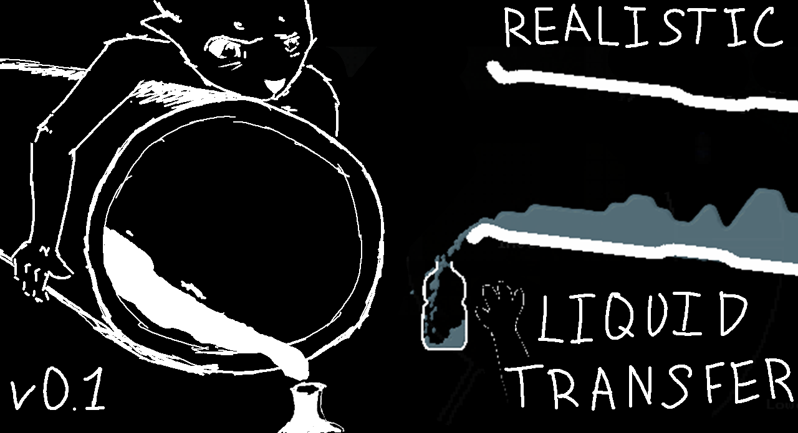

# Realistic Liquid Transfer



---

## Description

Adds minigames for liquid transfer and draining

wip but playable, sill a bit laggy, not tested with other mods

Let me know if anything is broken

Source code: github.com/DaiterGG/RealisticLiquidTransfer

## Controls
- Complete simulation with sound and per liquid properties
- LMB to move
- RMB to rotate
- 'Funnel' item that help with transfer, easy to craft, cannot drop as loot, works from the inventory

## Installation

Install with a mod manager (Thunderstore Mod Manager), and you should be set!

For a manual install, place `RealisticLiquidTransfer.dll` inside your game's `BepInEx/plugins` folder:

```
Casualties Unknown/
└── BepInEx/
    └── plugins/
        ├── RealisticLiquidTransfer.dll
        └── (as well as any additional mods!)
```
